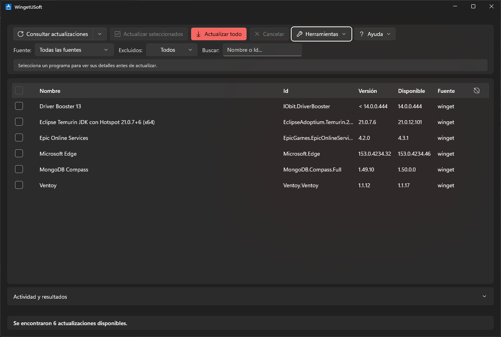
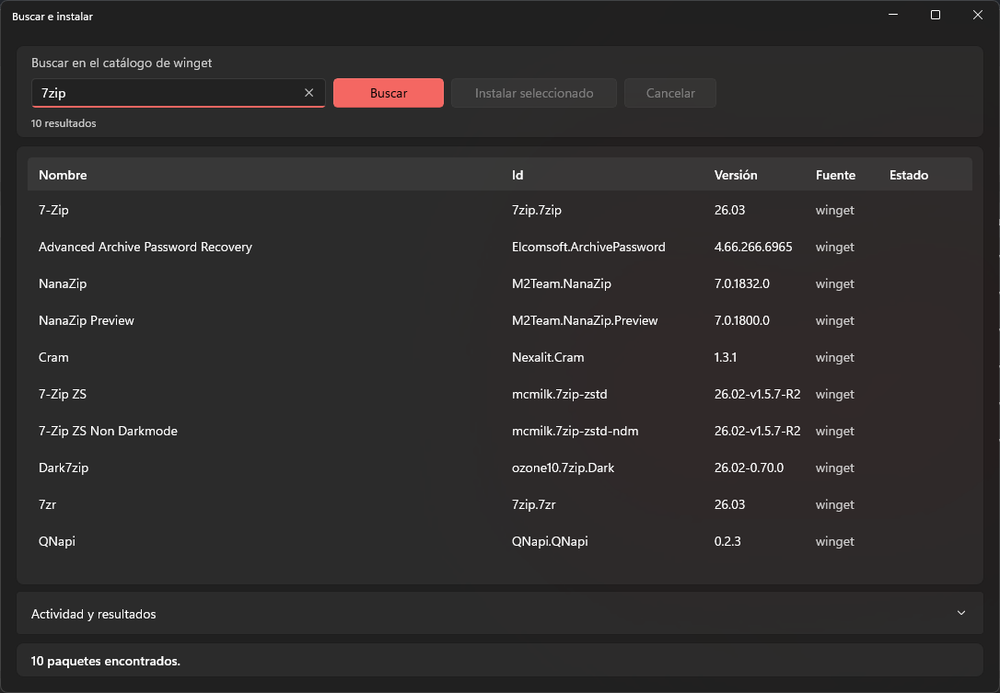
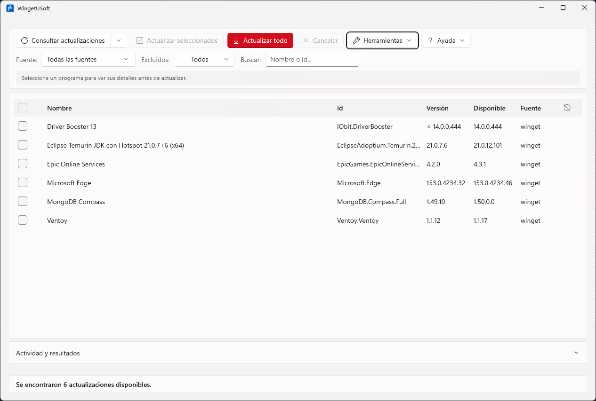
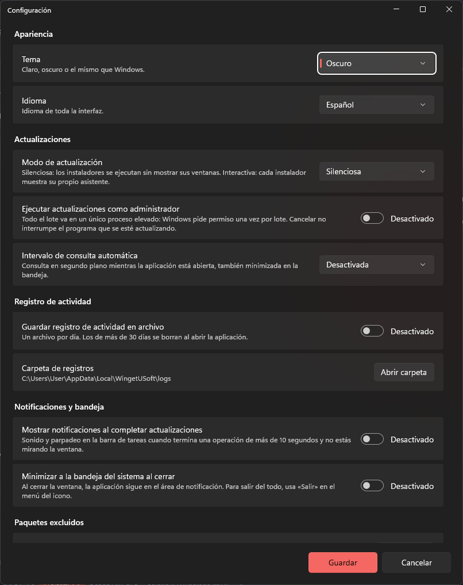

# WingetUSoft


[](https://github.com/xfiberex/WingetUSoft/actions/workflows/ci.yml)
[](https://github.com/xfiberex/WingetUSoft/actions/workflows/codeql.yml)


Interfaz gráfica (WinUI 3) para **gestionar tu software** con **winget** en Windows: busca e instala
programas nuevos, consulta cuáles tienen versión nueva y actualiza los que elijas (uno, varios o todos),
desinstala lo que ya no usas, y **exporta o importa tu lista de paquetes** para reinstalarlo todo en otro
equipo — sin tocar la línea de comandos.



<details>
<summary>Más capturas (buscar e instalar, tema claro, Configuración)</summary>







</details>

## Qué hace

**Actualizar**
- Lista los paquetes con versión disponible; un solo botón **Consultar**, con la variante que incluye las
  **versiones desconocidas** (`<`) en su desplegable, y recuerda la última que elegiste.
- **Actualización selectiva**: marca con la casilla (o todos con `Ctrl+A`) y actualiza. La selección
  sobrevive a buscar, ordenar y filtrar, y el botón dice cuántos hay marcados.
- **Estado por fila durante el lote** — en cola, actualizándose, actualizado o fallido con el motivo al
  pasar el ratón —, progreso que avanza también *dentro* de cada paquete, y un **único resumen de fallos**
  al terminar en vez de un modal por cada uno.
- Modo **silencioso o interactivo**, y lotes elevados por un worker interno con named pipe, sin scripts
  temporales en disco.

**Instalar, desinstalar y mover tu lista**
- **Buscar e instalar** desde el catálogo de winget, con progreso y registro en vivo; lo que ya tienes sale
  marcado como instalado.
- **Desinstalar** cualquier programa, con confirmación. Al terminar se abre la **limpieza de residuos**:
  propone las carpetas que el desinstalador dejó atrás, **nada viene marcado** y el borrado es recursivo,
  no pasa por la papelera y no se puede deshacer.
- **Exportar** al formato JSON nativo de winget (con las versiones exactas si quieres) e **importar** en
  otro equipo: lo ya instalado se actualiza y lo que ya no está en el catálogo se salta sin abortar.

**Encontrar lo que buscas**
- Búsqueda en vivo por nombre o Id, columnas ordenables (las versiones, **numéricamente**: `1.9.0` antes
  que `1.10.0`) y un panel con la descripción del paquete y sus enlaces, en cualquier idioma de Windows.
- Las cuatro listas dicen siempre en qué punto están —consultando, sin datos, todo al día, sin
  coincidencias, cancelada o fallida— y traen el botón que toca: *Consultar* o *Reintentar*.
- La tabla manda: acciones, filtros y detalle van en una sola barra, y el registro de actividad está
  plegado hasta que empieza una operación o algo falla.

**Configuración**
Todas las preferencias viven en la ventana **Configuración**; **Herramientas** solo tiene acciones.

- **Omitir una versión** concreta de un paquete (reaparece cuando salga otra) o **excluirlo** para siempre.
- **Historial** de cada actualización e instalación (máx. 500 entradas) con filtros y exportación a CSV;
  exportación de la lista a CSV/TSV con neutralización de fórmulas, segura para Excel.
- Tema claro/oscuro, cinco idiomas (ES/EN/PT/FR/IT) con plurales reales, auto-comprobación periódica,
  aviso al terminar un lote, bandeja del sistema y log diario opcional.

**Accesibilidad**
- Manejable **solo con teclado**, incluidas las cabeceras de la tabla y el menú contextual de la fila
  (Shift+F10). Atajos: `F5` consultar, `Ctrl+F` buscar, `Ctrl+A` marcar todo, `Supr` excluir, `Esc` cancelar.
- Las filas se anuncian como "*programa*, versión instalada X, disponible Y", y los colores del registro
  cumplen **WCAG AA** en claro y oscuro, comprobado por tests en las cuatro ventanas con registro.
- Con un **tema de contraste** de Windows la app usa tus colores: el registro deja de colorear (✔ y ✖
  siguen marcando el resultado) y el fondo translúcido se sustituye por el color de ventana del tema.

> 📋 Lo implementado y lo que viene, en la **[hoja de ruta](ROADMAP.md)**. El porqué de cada decisión, en
> **[CONTEXT.md](CONTEXT.md)**.

## Instalación

Descarga `WingetUSoft-Setup-x.y.z.exe` de **[Releases](https://github.com/xfiberex/WingetUSoft/releases)**
y ejecútalo. Comprueba las dependencias y **descarga solo lo que falte** (VC++ Redist y .NET 10 Desktop
Runtime); en un Windows al día no descarga nada.

| Requisito | |
|---|---|
| Sistema | Windows 10 (build 19041) u 11 |
| Permisos | **Sin administrador** para el uso normal; eleva puntualmente, y solo si lo pides |
| winget | App Installer, cualquier versión reciente desde Microsoft Store |

El instalador **no está firmado** (no hay certificado de código), así que SmartScreen dirá «editor
desconocido». Puedes verificar la descarga con el `.sha256` que acompaña a cada release.

La app busca versiones nuevas **al arrancar** y en *Ayuda → Buscar actualización*, y muestra el changelog
antes de instalar nada.

> **Cómo se verifica una actualización.** La descarga va por **HTTPS** desde GitHub Releases y, antes de
> ejecutar nada, el instalador se verifica: primero por **firma Authenticode** si la tiene y, si no,
> contra el **SHA-256** publicado como asset del release. Si no cuadra ninguna de las dos, el archivo se
> borra y la actualización se aborta. Esto detecta manipulación o corrupción en tránsito, **no** un
> compromiso de la cuenta de GitHub: el hash y el `.exe` salen del mismo release.

**Volver a una versión anterior.** No hay botón de «deshacer», pero la vuelta atrás es manual y sencilla:
descarga el instalador de la versión que quieras (todas siguen publicadas) y ejecútalo **encima** de la
instalación actual, sin desinstalar. Todos comparten `AppId` y reutilizan el directorio previo
(`UsePreviousAppDir=yes`), así que sustituye en vez de duplicar, y tus datos —en
`%LocalAppData%\WingetUSoft\`— no se tocan. Al arrancar verás el aviso de la versión más nueva: es una
barra informativa que se cierra con su aspa, aunque volverá en cada arranque hasta la siguiente versión.
Y cuéntame qué falló en un [issue](https://github.com/xfiberex/WingetUSoft/issues); si la app ni abre,
adjunta `%LocalAppData%\WingetUSoft\crash.log`.

## Tus datos

| Artefacto | Ruta |
|---|---|
| Configuración | `%LocalAppData%\WingetUSoft\settings.json` |
| Logs diarios | `%LocalAppData%\WingetUSoft\logs\YYYY-MM-DD.log` (se conservan **30 días**) |
| Registro de fallos | `%LocalAppData%\WingetUSoft\crash.log` |

Los registros se purgan al arrancar; los archivos que la app no escribió, no se tocan. Si `settings.json`
se corrompe, se guarda una copia con timestamp y se restauran los valores por defecto.

## Desarrollo

Requiere el .NET SDK 10 (e [Inno Setup 6](https://jrsoftware.org/isinfo.php) para el instalador).
[CONTRIBUTING.md](CONTRIBUTING.md) explica qué se espera de un cambio.

```powershell
dotnet build WingetUSoft.slnx
dotnet run --project src/WingetUSoft/WingetUSoft.csproj

.\verify.ps1          # compilación (warnings como error), estilo, unitarias y dependencias
.\verify.ps1 -Full    # además los UI tests de FlaUI, que conducen la app real
git config core.hooksPath .githooks   # lanza la verificación rápida antes de cada push
```

Los **UI tests** (FlaUI + UIA3) necesitan una sesión de escritorio interactiva y desatendida, pero **no**
elevación: la app corre `asInvoker`.

| Tarea | Comando |
|---|---|
| Instalador + `.sha256` (en `installer\Output\`) | `src\WingetUSoft\installer\build-installer.ps1` |
| Firmar (opcional) | `… -CertThumbprint <huella>` o `… -CertFile cert.pfx -CertPassword (Read-Host -AsSecureString)` |
| Cortar una versión | `.\release.ps1 -Version X.Y.Z` (`-DryRun` para ver el plan) |
| Regenerar las capturas | `.\tools\capture-screenshots.ps1 [-Theme dark -Language en]` |

`release.ps1` valida, ejecuta las pruebas **unitarias y de UI**, actualiza `<Version>`, compila el
instalador, etiqueta, sube y crea el GitHub Release con el `.exe` y su `.sha256`. Con `.pfx`, el
certificado se importa al almacén del usuario y se firma por huella, para que la contraseña no pase por la
línea de comandos de `signtool`. Las capturas se toman conduciendo la app real, respaldando y restaurando
tu `settings.json`.

### Integración continua

| Workflow | Cuándo | Qué hace |
|---|---|---|
| [**CI**](.github/workflows/ci.yml) | push a `main`, cada PR, manual | El mismo `verify.ps1` del local, sin `-Full` |
| [**CodeQL**](.github/workflows/codeql.yml) | igual, más cada lunes | Seguridad del C# (`security-extended`), compilando de verdad: el código que genera el compilador XAML solo existe tras compilar |
| [**Dependabot**](.github/dependabot.yml) | cada lunes | Acciones de GitHub. Con NuGet apenas propone nada: las resuelve en Linux y esto es `net10.0-windows` |

Los UI tests **no corren en GitHub**: un runner hospedado no tiene escritorio interactivo. Por eso la
puerta de publicación sigue siendo local, y un PR en verde no basta para subir Windows App SDK o
H.NotifyIcon, que cambian lo que se ve.

### Arquitectura

| Capa | Contenido |
|---|---|
| `src/WingetUSoft/Core/` | Lógica pura y testeable: parseo de winget, orden de versiones, paleta del registro, exportación |
| `src/WingetUSoft/Services/` | Efectos: winget, GitHub (auto-actualización verificada), rastreo de residuos |
| `src/WingetUSoft/Settings/` · `Localization/` | Persistencia · las cadenas en los cinco idiomas (`L.T("clave")`) |
| `src/WingetUSoft/UI/` | WinUI 3: las siete ventanas, los diálogos y los controles compartidos |
| `src/WingetUSoft/installer/` | Inno Setup (`installer.iss`) + `build-installer.ps1` |
| `tests/` | Unitarias (`WingetUSoft.Tests`) y de UI (`WingetUSoft.UiTests`, FlaUI) |

## Licencia, privacidad y contacto

- **[MIT](LICENSE)**: úsalo, modifícalo y redistribúyelo, incluso en proyectos privativos, conservando el
  aviso de copyright. Sin garantía. Atribuciones en
  [THIRD-PARTY-NOTICES.txt](THIRD-PARTY-NOTICES.txt); ambos textos, también en *Ayuda*.
- **Privacidad**: sin telemetría ni datos personales. Solo se conecta a Internet para consultar o instalar
  paquetes vía winget y para comprobar actualizaciones de la app en GitHub Releases (HTTPS).
- **Errores y sugerencias**: en los [issues](https://github.com/xfiberex/WingetUSoft/issues).
  **Vulnerabilidades**: en privado, según [SECURITY.md](SECURITY.md).
- **Apoyar el proyecto**: donación voluntaria (PayPal) desde *Ayuda → Acerca de*. Ninguna función es de
  pago.
